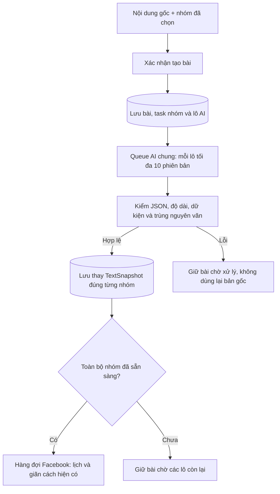

# Facebook nhóm — AI viết lại nội dung theo lô 10 phiên bản

Ngày 2026-11-07 (UTC+07). **ĐÃ TRIỂN KHAI CỤC BỘ** sau yêu cầu implement của người dùng. Owner: Codex coordinator, tuần tự/tự review, không agent con. ChatGPT/Gemini Web công bố capability **TRIAL**, chưa coi fixture là xác minh live. Nghiệm thu provider thật/WebView2 còn mở; không đăng Facebook thật trong lượt này.

## Cập nhật lựa chọn cách đăng — 2026-11-07 (FBR6)

Theo yêu cầu mới nhất, form nhóm và từng bài trong Hẹn giờ đăng có **Viết lại nội dung / Đăng nguyên bản**. Form mới mặc định viết lại; nguyên bản giữ nguyên chữ và ảnh cho mọi nhóm, bỏ qua provider/chunk/job AI. Đây là lựa chọn tường minh, không phải fallback khi AI lỗi. Bài chỉ có ảnh không tạo caption ở cả hai chế độ.

- Request tạo bài mang `rewriteContent`; caller cũ bỏ trường này được hiểu là nguyên bản. UI luôn gửi rõ lựa chọn, cả khi xác nhận lại. Băm mã lô gồm lựa chọn; đổi chế độ phải tạo mã mới, replay cùng bản xác nhận giữ mã cũ.
- Nháp lưu `FacebookDraft.rewrite_content`, mở/sửa giữ lựa chọn; nháp v13 giữ mặc định viết lại trước đây. Bản sao bài nhóm có chunk AI tiếp tục viết lại, bài nguyên bản giữ nguyên bản; nhân bản trong hẹn giờ giữ lựa chọn riêng của dòng.
- Schema cuối v14; gộp SQL nâng cấp v6–v13 trong `upgrade-to-v14.sql`, thêm đúng một cột nháp, backup trước nâng cấp và transaction toàn chuỗi. Không đổi task/job đã tạo, không mở DB cá nhân.
- Owner Codex coordinator tuần tự/tự review; baseline Facebook UI16/16, application180, rewrite70 PASS. Sau sửa: Facebook UI18/18, toàn web75/75, application180, rewrite78, FinalSchema (SQL/model parity, v13→v14 giữ nháp/lựa chọn/backup/restart và hồi quy v6–v12) PASS. TypeScript/Vite/Desktop Release 0warning/error PASS. Visual fixture form Light1280/Dark800/Light600 và lịch Light1280/Dark800 đã kiểm, không tràn ngang; headless Edge bị sandbox chặn, lượt ngoài sandbox trên profile tạm PASS.
- NOT_RUN: WebView2/DPI125–150, provider và đăng Facebook thật. Giữ mọi sửa đổi sẵn có, không commit/push. CodeGraph không phản hồi, đã đối chiếu source trực tiếp. Tài liệu này thay yêu cầu bắt buộc AI cho mọi bài có chữ ở bản trước.

## 1. Yêu cầu và quyết định đề xuất

Người dùng xác nhận: **từ một nội dung gốc, mỗi lần AI tạo 10 phiên bản cho 10 nhóm**, không phải đưa 10 bài gốc khác nhau vào một lần hỏi.

- Mỗi nhóm nhận một phiên bản riêng, cùng ý chính và độ dài tương tự nội dung gốc. Chỉ thay cách diễn đạt, mở bài, cấu trúc câu; không bịa thông tin.
- Chia danh sách nhóm đã xác nhận thành các lô tối đa 10 nhóm. Lô cuối sinh đúng số còn thiếu: 23 nhóm → 10 + 10 + 3 phiên bản; không sinh dư hoặc tái dùng 10 bản theo vòng lặp.
- Lưu nội dung AI hợp lệ **thay `FacebookPostTask.TextSnapshot`** của đúng nhóm trước khi gửi; hàng đợi, xem chi tiết và lịch sử đều đọc bản đã lưu này. Adapter Facebook không gọi AI lại.
- Các lô AI chạy song song theo **Số tác vụ chạy đồng thời** của tài khoản AI, đồng thời tuân thủ budget và per-task limits hiện có. Một lô 10 phiên bản chiếm một job/tab.
- Chạy khi người dùng chọn Viết lại nội dung và xác nhận tạo bài nhóm mới có chữ. Bài chỉ có ảnh không có chữ giữ luồng cũ; không tự sáng tác caption từ ảnh. Bài đã tạo trước tính năng không bị viết lại hồi tố.
- Cả bài chỉ được đăng khi **mọi nhóm trong bài đã có nội dung hợp lệ**. Một lô AI lỗi giữ bài chờ xử lý; không đăng bằng nội dung gốc và không tự gửi lại AI. Bài khác vẫn xử lý độc lập.
- Đề xuất ngưỡng độ dài **85–115% số ký tự Unicode của bản gốc**, tính cả khoảng trắng/link; vẫn giữ trần 10.000 ký tự hiện tại. Đây là lựa chọn thiết kế cho “tương tự”, chưa phải tỷ lệ do người dùng chỉ định.

Mục tiêu là giảm việc lặp nguyên văn. Kiểm tra nội dung không thể bảo đảm Facebook sẽ không đánh dấu trùng lặp, cũng không tự chứng minh mọi phiên bản giữ đúng ý.

Đọc cùng [trạng thái](../agents/STATUS.md), [task](../agents/TASKS.md), [quy tắc kỹ thuật](../agents/ENGINEERING_RULES.md), [plan nguồn](SOURCE_PLAN.md), [tab Đăng bài](20261106-facebook-posts-tab.md), [handoff nhóm](FACEBOOK_GROUPS_HANDOFF.md), [Settings](SETTINGS_PLAN.md), [queue/capacity](QUEUE_EXECUTION_SETTINGS_PLAN.md), [browser](UI_BROWSER_PLAN.md) và [theme](UI_THEME_PLAN.md).

## 2. Hiện trạng đã đối chiếu

Baseline khảo sát: HEAD `e1721aa` + working tree đang có nhiều thay đổi, gồm Analytics AI và ReferenceVideo. Không hoàn tác hoặc nhận các thay đổi này là sản phẩm của task mới. Đã gọi CodeGraph trước tra code; công cụ trả `Transport closed`, nên đọc source trực tiếp. Không tự index lại.

| Thành phần | Hiện trạng và điểm cần nối |
|---|---|
| `FacebookPublishingService.CreateBatchAsync` | Một batch tạo N task theo thứ tự nhóm, mọi task hiện nhận cùng `request.Text`; có request hash chống replay. |
| `FacebookPostTask` | Đã có `TextSnapshot`, `SortOrder`, revision, lease, trạng thái và media snapshot; đủ chỗ giữ nội dung cuối của từng nhóm. |
| `FacebookPostBatch` | Quản lý bài, tên/pause/revision; chưa giữ nguồn viết lại hoặc liên kết lô AI. |
| `ProcessNextAsync` và checkpoint trước click | Chọn task Queued, giữ lịch, pacing 5 phút/profile, khóa profile với Analytics; cần thêm điều kiện nội dung sẵn sàng ở cả claim và checkpoint. |
| `FacebookPosts.tsx` | Chi tiết hiện chỉ in `tasks[0].text`; phải hiển thị nội dung theo từng nhóm sau thay đổi. Nhân bản hiện cũng lấy bản đầu. |
| Queue AI và AnalyticsAnalysis | Đã có job độc lập không cần Project, account pool, tab/slot/lease, checkpoint và raw text result; có thể mở thêm loại job Facebook, không tạo Project giả. |
| Settings | Có global MaxConcurrentJobs/MaxOpenBrowsers; capacity tài khoản AI lấy MaxTabs. Chưa có provider riêng cho viết lại Facebook. |
| Schema | Bootstrap hiện ở v12; CHECK của Job chỉ chấp nhận video hoặc AnalyticsAnalysis. Không thể chỉ thêm tên task type rồi coi queue đã hỗ trợ. |

Phạm vi bản đầu: đăng **nhóm**, chữ/link + ảnh đang có. Không mở sang trang cá nhân/Page, không sửa bài đã đăng, không thêm API key/provider mới, embedding hoặc scheduler AI thứ hai.

## 3. Luồng thực hiện



Chờ những lô đã tạo còn lại; **không sinh lại job hoặc tự retry lô lỗi**.

1. Backend xác thực account, nhóm thuộc account, thứ tự, chữ/media như hiện tại. Chốt source text, danh sách task, provider, prompt version và request hash trước khi tạo job.
2. Trong transaction ngắn, tạo bài/task, các bản ghi lô AI và Job bền vững. Chưa mở browser, chưa cho Facebook claim task. Replay cùng request ID trả đúng bài/job đã tạo, không sinh thêm biến thể.
3. Xếp các job `FacebookContentRewrite` vào queue AI chung; một lô chỉ thuộc một bài gốc. Không trộn nguồn giữa bài hoặc tài khoản Facebook.
4. Mỗi job dùng conversation/tab riêng trên profile AI đã xác minh. AI nhận một source text và số phiên bản cần tạo; trả kết quả gắn với các slot ID ổn định do host cấp.
5. Lưu raw response vào kết quả Job. Parser xác thực toàn bộ lô; giao dịch apply thay nội dung các task đúng mapping, đồng thời đánh dấu lô đã apply. Không áp một phần trong cùng lô nếu còn bản không hợp lệ. Job Succeeded chưa đủ mở đăng nếu apply chưa commit; event chỉ đánh thức, service phải đọc lại DB và đối soát lô có response chưa apply, không phụ thuộc event được giao đúng một lần.
6. Sau khi mọi lô apply, đánh thức hàng đợi Facebook. Mỗi task đăng đúng bản đã lưu và media cũ; nội dung bất biến từ khi task bắt đầu Preparing.

Với hẹn giờ: chuẩn bị AI ngay sau xác nhận để có nội dung sớm; **không mở Facebook trước giờ hẹn**. Nếu app vẫn chạy nhưng AI chưa xong lúc đến giờ, hiển thị chờ AI và chỉ đăng khi sẵn sàng theo pacing. Nếu app tắt qua giờ hẹn, giữ quy tắc lỡ lịch hiện có, chờ người dùng xử lý; AI hoàn tất không được tự bỏ trạng thái này.

## 4. Nội dung, prompt và kiểm tra kết quả

### Đầu vào và định dạng

Snapshot chứa version, batch/chunk ID, source text/hash, slot IDs liên kết task IDs, số bản cần sinh, khoảng độ dài, protected literals và prompt version/provider/config revision. Không gửi cookie, session Facebook, đường dẫn profile, media hoặc URL nhóm cho AI nếu không cần thiết; slot ID đủ để ghép kết quả. Nội dung nguồn luôn là dữ liệu không tin cậy, không phải chỉ dẫn hệ thống.

Ví dụ response cho lô cuối có hai nhóm:

```json
{
  "schemaVersion": 1,
  "variants": [
    { "slotId": "slot-21", "text": "Nội dung viết lại thứ nhất..." },
    { "slotId": "slot-22", "text": "Nội dung viết lại thứ hai..." }
  ]
}
```

Prompt yêu cầu giữ ngôn ngữ, giọng điệu, sản phẩm/dịch vụ, thông điệp, lời kêu gọi và mọi dữ kiện; giữ nguyên link, số điện thoại, giá, địa chỉ, mã sản phẩm/khuyến mại, tên riêng. Không thêm cam kết, đánh giá hoặc ưu đãi mới; không thêm lời giải thích hay số thứ tự vào phần text. Các phiên bản cần khác nhau ở cách diễn đạt, không chỉ thêm khoảng trắng/emoji.

### Validation

- Đúng schema/version, đúng số bản yêu cầu, slot ID không thiếu/trùng/lạ. Giới hạn kích thước response và độ dài từng text; không cắt JSON hoặc text để cố cho qua.
- Đếm Unicode nhất quán frontend/backend; mỗi bản nằm trong khoảng đề xuất ở §1 và ≤10.000 ký tự. Với bản rất ngắn hoặc gần toàn dữ kiện cố định khiến không đủ khả năng tạo các bản khác nhau, trả lỗi rõ thay vì bịa thêm hoặc tự nới ngưỡng.
- Chuẩn bị protected literals xác định được (URL, điện thoại, số/giá/mã rõ ràng) và kiểm giữ nguyên, không thêm dữ kiện số/link mới. Những tên/địa chỉ không nhận diện chắc chắn dựa vào prompt và kiểm đọc mẫu; không tuyên bố validator bảo đảm ngữ nghĩa.
- Chuẩn hóa Unicode và khoảng trắng để so trùng; từ chối bản giống nguyên văn nguồn hoặc trùng bản khác **trên toàn bộ bài**, kể cả lô chạy song song. Không dùng khác biệt hoa/thường hoặc khoảng trắng làm bằng chứng đủ khác.
- Kiểm tra liên lô trong transaction apply với các bản đã được nhận. Khi hai lô trả trùng, chỉ một lô được nhận; lô còn lại lỗi và chờ xử lý. Không dựa vào một tập hash chỉ có trong RAM, không gọi AI sửa tự động.
- Capability phải hỗ trợ tác vụ mới và đủ giới hạn input/output cho source + hướng dẫn + tối đa 10 bản. Kiểm giới hạn trước gửi; nếu không đủ, `RewriteInputTooLarge`/`RewriteOutputTooLarge`, giữ nguyên nguồn và chặn bài. Không âm thầm cắt nguồn hoặc đổi sang lô nhỏ hơn. Trial live cần xác minh response dài thực sự.

## 5. Song song, lỗi và recovery

Số job viết lại đang chạy không vượt phần capacity tài khoản/provider còn trống, global concurrent-job budget còn trống và per-task limits. Profile mới còn phải có browser budget; một browser có thể chứa nhiều tab job theo cơ chế hiện tại. Slot còn trống sau các job video/Analytics mới được dùng cho viết lại, không tạo semaphore riêng bỏ qua reservation ở DB.

Ví dụ: 50 nhóm → 5 job. Nếu capacity khả dụng là 3 thì chạy trước 3 lô (tạo 30 bản), sau đó nhận 2 lô còn lại. Với 23 nhóm là 3 job cho 10/10/3 bản. Giảm giới hạn không hủy job đang chạy, chỉ chặn nhận thêm. **Đồng thời AI không thay pacing đăng Facebook 5 phút/profile.**

- Khi chọn viết lại mà thiếu provider: báo cấu hình hoặc cho người dùng chủ động chọn Đăng nguyên bản; không tự fallback. Provider đã chọn nhưng thiếu account/session/capability: lưu lý do chờ/lỗi đúng provider, CTA sang Settings, không fallback ngầm.
- Tạm dừng bài: chặn reserve job AI mới và claim Facebook. Job AI đã gửi có thể hoàn tất/lưu nội dung, nhưng không mở đăng Facebook; tiếp tục không sinh lại bản đã hợp lệ.
- Hủy bài: hủy job AI chưa chạy, truyền cancel vào job đang chạy; kết quả tới muộn không được apply vào task đã hủy. Không hủy cưỡng bức task Facebook đã Submitting.
- Lỗi AI/parser/lưu DB: không đăng bản gốc, không ghi đè bản đã apply tốt. Nếu raw response đã có, cho parse/apply lại cục bộ trước khi nghĩ tới gọi AI mới.
- Thử lại thủ công chỉ cho lô lỗi/chưa apply; giữ mapping và nguồn ban đầu, không viết lại các nhóm đã sẵn sàng/đã gửi. Nếu lần cũ có thể đã submit, phải xử lý checkpoint/đối soát trước khi gửi lại. Không tự retry sau lỗi hoặc restart theo NR1.
- Crash sau AI trả về nhưng trước apply: dùng raw response đã lưu để apply một lần nếu còn hợp lệ. Crash sau apply trước cập nhật UI: đọc DB, không thay text lần hai. Claim/apply phải kiểm lease token, revision, scope và trạng thái hiện hành, không chỉ dựa vào event.
- Chặn đăng ở cả chọn candidate, CAS Queued→Preparing và checkpoint trước click: chỉ batch yêu cầu rewrite đã hoàn tất và task có bản apply hợp lệ mới qua được. Không để nút Đăng ngay/Tiếp tục hoặc sự kiện job thành công bỏ qua barrier này.

## 6. Lưu bền, contract và UI

### Dữ liệu tối thiểu đề xuất

- `FacebookPostBatch`: thêm cờ yêu cầu rewrite và `OriginalTextSnapshot` bất biến làm nguồn chung; lưu provider/config cần thiết trong snapshot job. Nguồn giữ nội bộ để kiểm chứng/thử lại/nhân bản, **nội dung đăng thực tế vẫn là TextSnapshot đã thay**; không thêm hệ thống lịch sử phiên bản.
- Một bảng mới `FacebookRewriteChunk`: ID, BatchId FK, ordinal, mapping slot→task có thứ tự, trạng thái apply/thời điểm và lỗi chuẩn bị nếu chưa tạo được job. UNIQUE(BatchId, ordinal). Trạng thái chạy lấy từ Job, không nhân đôi toàn bộ lifecycle.
- `Job`: thêm task type `FacebookContentRewrite` và FK nullable `FacebookRewriteChunkId` với unique index. Job này không có Project/Scene/AnalyticsReport; job Analytics/video giữ đúng tổ hợp scope cũ. Nới CHECK theo ba trường hợp tường minh, không cho job mất owner hoặc tham chiếu chéo scope.
- Bản ghi nguồn/task/chunk/job được commit trước notify queue. Một job cho mỗi chunk, retry theo cơ chế attempts hiện có; apply có CAS và kiểm cùng BatchId/ProfileId/TaskId. Không dùng task ID do model tự chọn để cập nhật tùy ý.
- Bước rewrite đã thêm ở v13; schema hiện hành v14 bổ sung lựa chọn trong nháp theo FBR6 ở đầu tài liệu. Đây là bổ sung tính năng, đề xuất nâng cấp giữ dữ liệu như v12: SQLite backup API, transaction/rollback, parity DB mới/nâng cấp; không reset DB cá nhân.

Thay đổi có chủ đích so với [D3 bản chụp bất biến](FACEBOOK_PUBLISHING_PLAN.md): chỉ task của bài mới có yêu cầu rewrite được phép thay text **một lần trong bước chuẩn bị AI**, trước Preparing. Sau apply, sửa nháp/prompt/Settings không thay bài đã tạo. Không nới khả năng sửa bài đang gửi hoặc lịch sử.

### Settings và màn Facebook

- Thêm **AI viết lại bài nhóm Facebook** (`FacebookRewriteProvider`) trong AI & Prompt, chọn ChatGPT Web/Gemini Web có capability phù hợp. Chốt provider khi tạo bài; không mượn ScriptProvider hoặc AnalyticsProvider. Không thêm ô số đồng thời riêng.
- Form xác nhận nói rõ “AI tạo một nội dung riêng cho mỗi nhóm, tối đa 10 bản/lượt”, provider đã chọn và số lô. Chỉ khi chọn Viết lại nội dung, hành động xác nhận mới cho phép viết lại rồi đăng theo Đăng ngay/Hẹn giờ; chọn Đăng nguyên bản bỏ qua AI.
- Danh sách bài có trạng thái thật: Chờ AI, Đang viết lại, Đã có X/N nội dung, Cần xử lý AI, Sẵn sàng đăng; tách số nội dung sẵn sàng với số nhóm đã đăng. Không dùng timer tạo phần trăm giả.
- Chi tiết từng nhóm hiển thị **đúng nội dung riêng của task**; lịch sử giữ nội dung đã gửi. Không chỉ hiển thị text nhóm đầu cho cả bài.
- Nhân bản cả bài dùng OriginalTextSnapshot làm nguồn tạo loạt mới; Đăng lại từ một task nạp đúng text đã dùng cho task đó. Cả hai chỉ tạo job sau khi người dùng xác nhận bài mới. Nháp vẫn giữ bản đang soạn, không tự bị thay bởi job đã tạo.
- Hiển thị lỗi và thao tác theo đúng bài/lô; giữ trạng thái khi đổi màn, polling chỉ lúc cần. Đăng nhập qua Settings, browser automation ẩn. Kiểm Light/Dark, bàn phím, layout hẹp và WebView2/DPI.

## 7. Các lát triển khai và dependency

FBR0–FBR4 đã tích hợp cục bộ; FBR5 còn qualification live/WebView2. Một owner cho mỗi lát; coordinator giữ contract/schema/composition root. Đã chụp baseline working tree và kiểm Release/Facebook/schema trước sửa. Giữ các thay đổi Analytics, ReferenceVideo và điều hướng có sẵn/được cập nhật đồng thời; không hoàn tác hoặc nhận các thay đổi ngoài phạm vi là của FBR. Thử 10 bản trên provider thật thuộc qualification FBR5, không dùng fixture để nâng capability thành VERIFIED.

| ID | Dependency | Kết quả cần đạt và phạm vi file |
|---|---|---|
| FBR0 | Người dùng yêu cầu triển khai; ownership và baseline hiện hành rõ | Chốt ratio/provider/trigger, DTO/state/SQL, capability riêng và giới hạn input/output. Probe provider thật chuyển FBR5; không gắn VERIFIED khi chưa thử. Files: plan này, STATUS/TASKS, evidence trong plan; chưa đăng Facebook. |
| FBR1 | FBR0 | Scope job/persistence/Settings. Files: `Contracts/Facebook/FacebookDtos.cs`, `Contracts/Jobs/JobDtos.cs`, `Contracts/Settings/SettingsDtos.cs`, `Infrastructure/Persistence/Entities/{Job,FacebookPostBatch}.cs`, thêm `FacebookRewriteChunk.cs`, configurations/DbContext, SQL nâng cấp + final-schema/bootstrap; `Application/Settings/SettingsService.cs`. Test SQLite nâng cấp/rollback/FK/invalid scope/replay trước bước tiếp. |
| FBR2 | FBR1 | Prompt/parser/capability và AI job. Thêm `Application/Facebook/FacebookContentRewriteService.cs`, `FacebookContentRewriteResultParser.cs`; sửa `Jobs/{JobModels,JobReservation,JobScheduler,JobService,JobRetryAndCancelPolicy,ProductionJobExecutor}.cs`, provider dispatch/capabilities/ChatGPT/Gemini adapter và automation theo nhánh thực sự cần, DTO provider nếu cần. Test sinh/mapping/lỗi/giới hạn/cancel/lease/capacity chung; giữ Analytics và video. |
| FBR3 | FBR2 | Nối CreateBatch, apply transaction và barrier đăng; pause/cancel/restart/retry. Files: `Application/Facebook/FacebookPublishingService.cs`, service rewrite, `Desktop/Bridge/Handlers/FacebookHandlers.cs`, host wiring/recovery tại `Desktop/MainWindow.xaml.cs` và gatekeeper nếu cần. Test end-to-end SQLite + provider/browser giả, crash/replay/cross-chunk duplicate/late result. |
| FBR4 | FBR3, contract đã chốt | UI Settings, form xác nhận, tiến độ/nội dung từng nhóm, nhân bản/đăng lại. Files trong `Web/src/features/facebook/{FacebookPage,FacebookPosts,facebookApi}.tsx/ts`, `features/settings/{AiProviderSettingsPanel,aiSettingsApi,SettingsPage}`, `contracts/bridge.ts`; test DOM tại vùng tương ứng. Tên/đuôi file cụ thể đối chiếu trước sửa. |
| FBR5 | FBR4 | Hồi quy và nghiệm thu theo §8; cập nhật plan hiện hành/handoff/Settings/UI_BROWSER/STATUS/TASKS, dọn mô tả trùng hoặc lỗi thời nhưng giữ evidence chưa đóng. Chỉ đánh DONE khi có đủ kiểm chứng, ghi rõ live nào NOT_RUN. |

Đường dẫn rút gọn trong bảng tương ứng `src/Fraylo.<layer>/`; test dùng các project smoke hiện có. Chỉ tạo file mới khi thực sự có trách nhiệm mới; không tách mọi helper thành interface. Không thêm dependency hoặc nâng version thư viện cho tính năng này.

## 8. Acceptance và kiểm chứng bắt buộc khi triển khai

- [x] N=1/9/10/11/23/50 cho đúng số job/bản, ổn định mapping/thứ tự dù lô hoàn tất đảo thứ tự; không sinh dư và không dùng bản theo vòng lặp.
- [x] Parser loại JSON lỗi/cắt cụt, slot sai/thiếu/thừa, text rỗng, lệch độ dài, mất/sửa dữ kiện được bảo vệ, trùng nguồn/trong lô/liên lô; xử lý emoji/tiếng Việt/nguồn ngắn/nguồn gần 10.000 ký tự.
- [x] Mỗi nhóm lưu đúng TextSnapshot AI; đóng/mở màn và restart vẫn đúng; browser giả nhận đúng bản đã lưu. Trước đủ toàn bài, không có đường nào claim/click Facebook bằng bản gốc.
- [x] SQLite thật kiểm replay cùng request, source khác cùng request, apply lặp, hai lô trả trùng đồng thời, CAS/cancel/late result, lỗi ghi/rollback và restart trước/sau apply; từng worker dùng DbContext riêng.
- [x] Fake provider + queue thật kiểm capacity 1/3, global budget và job video/Analytics đang bận, giới hạn task/browser, nhiều account, pause/giảm cap khi chạy; không vượt N slot và không mở hai owner cùng profile.
- [x] Fake clock kiểm AI trước lịch không mở Facebook, tới giờ chưa đủ nội dung vẫn chờ, app tắt qua giờ giữ lỡ lịch, Đăng ngay/Tiếp tục không bỏ barrier; pacing Facebook vẫn 5 phút/profile.
- [x] Hủy/retry một lô không sửa nhóm đã apply/đã gửi; checkpoint AI chưa rõ không tự resend; lỗi AI không chặn bài khác.
- [x] Schema DB mới và nâng từ v12 có cùng constraints/index; bảo toàn dữ liệu video/Analytics/Facebook/accounts/settings trên fixture; backup và lỗi giữa nâng cấp rollback đúng.
- [x] Build `Fraylo.sln` Release và Desktop, TypeScript/Vite; suites Facebook Application, Facebook browser, FinalSchema; hồi quy Desktop `t15`, `q1`, `concurrency`, `provider`, `analytics-ai`, `workflow`, `reference-video`, policy retry/recovery và web theo phạm vi thay đổi. Dùng lệnh/SDK hiện có, MSBuild tuần tự nếu baseline yêu cầu.
- [ ] Live AI trên ChatGPT/Gemini đã chọn: ít nhất một lô đủ 10 bản và lô cuối; lưu bằng chứng độ dài/dữ kiện/khác nhau, kiểm đọc nội dung thực tế và giới hạn output. Fixture không thay kết luận này.
- [ ] UI Light/Dark/hẹp, nội dung theo từng nhóm, keyboard, Settings save/conflict và WebView2 DPI125/150. Chỉ đăng Facebook thật khi có chỉ định thử riêng về account/nhóm/nội dung; chưa chạy ghi NOT_RUN.

## 9. Checkpoint của lượt lập plan

- Đã xác nhận nghĩa “10 bài một” với người dùng; đã đối chiếu luồng tạo task/snapshot, dispatch, AI queue/capacity, schema v12 và UI nội dung nhóm đầu.
- Đã tự review plan: một nguồn gốc → N bản → lưu đúng từng task; phân biệt đồng thời AI với pacing Facebook; có barrier, giới hạn provider, replay/cancel/recovery và kiểm chứng ngữ nghĩa còn giới hạn.
- Chỉ cập nhật tài liệu và liên kết; không sửa code/schema thực tế, không mở DB cá nhân, không gọi provider, không đăng bài, không commit/push.
- Kiểm tra tài liệu PASS: liên kết trong plan, liên kết ngược từ STATUS/TASKS/handoff, code fence và whitespace; `git diff --check` các tài liệu đã theo dõi PASS. STATUS/TASKS hiện bị Git ignore theo cấu hình repo, vẫn đã cập nhật checkpoint cục bộ. Python shim không chạy được; đã dùng PowerShell kiểm tra thành công.
- Build/test/provider live/WebView2: **NOT_RUN** trong lượt này vì chưa triển khai. Kiểm tra tài liệu ghi riêng lúc bàn giao, không dùng làm bằng chứng tính năng hoạt động.

## 10. Triển khai và bằng chứng — 2026-11-07

### Hành vi đã nối

- `FacebookContentRewriteService` stage batch/task/chunk/job trong cùng transaction tạo bài. Nguồn bất biến ở batch, request hash hiện có giữ idempotency; Job chốt provider, prompt version/settings revision và input/mapping. Không cần thêm hash nguồn trùng với request hash và phép đối chiếu nguồn khi apply.
- `FacebookContentRewrite` là owner thứ ba của Job bên cạnh video và Analytics, có FK/unique/CHECK riêng. Queue/account pool/per-task limits/global budget/lease dùng chung; không tạo Project giả hoặc queue AI khác. Host mở profile AI headless như Analytics.
- Một chunk tối đa10 task, lô cuối đúng số cần. Provider text adapter đọc JSON code block cho loại job mới; Gemini không bấm gửi lại khi chưa rõ đã gửi. Capability mặc định NOT_VERIFIED; trong chế độ Web trial hiện có chỉ mở TRIAL với EvidenceId null cho tác vụ mới.
- Parser kiểm Unicode85–115%, trần10.000, schema/slot/count, literals số/link, ký tự ẩn, trùng chuẩn hóa. Apply BEGIN IMMEDIATE kiểm scope/source/state, trùng liên lô và lưu nguyên lô. Không khẳng định tự kiểm đủ tên/địa chỉ/ngữ nghĩa; prompt và nghiệm thu đọc mẫu vẫn cần.
- Lỗi ghi giữa lô rollback mọi text, giữ raw response và báo `RewriteSaveFailed`; thao tác thử lại trường hợp này chỉ apply lại cục bộ. Lỗi parser/trùng cần yêu cầu thử lại tường minh. Uncertain không resend; lease hết hạn không commit thành công. Một lô lỗi không dừng hàng đợi bài khác.
- Barrier được kiểm tại candidate, claim và checkpoint Facebook. Pause trước AI Send trả job/slot về chờ, không cắt heartbeat của job đã gửi. Cancel dùng policy/worker cancellation hiện có; kết quả muộn không thay task đã hủy. Restart giữ AI chưa gửi chờ người dùng, giữ lỡ lịch Facebook.
- Settings có provider riêng; form/soạn hàng loạt thông báo bước AI, hàng đợi hiển thị số nội dung/lô/lỗi, text từng nhóm và retry đúng scope. Nhân bản cả bài dùng nguồn gốc. Không hiện giờ hoàn tất sớm nhất khi AI còn chặn bài. Giữ thay đổi FBQ Hàng đợi/Lịch sử/Nháp chung của chat khác.
- Schema13 nâng từ12 và các chuỗi hiện có, backup trước nâng, giữ dữ liệu. Chưa mở/nâng DB cá nhân trong lượt này; mở lại app sẽ đi qua bootstrap hiện hành.
- Task [UPG cài đè/schema](20261107-install-upgrade.md) được triển khai đồng thời và đã gộp các SQL nâng cấp vào `upgrade-to-v13.sql`; giữ entity/constraint/test FBR. Không khôi phục các migration rời đã được UPG thay thế. Build và kiểm FinalSchema cuối đối chiếu trên cấu trúc đã gộp này.

### Kiểm chứng

| Kiểm tra | Kết quả |
|---|---|
| Baseline trước sửa | Solution Release0warning/error; Facebook application180, FinalSchema v12 PASS. Hash working tree ở `.tmp/fbr-baseline/files.json`. |
| Build cuối | Solution/Desktop Release kèm TypeScript/Vite PASS; còn1warning nullable cũ tại AccountConcurrencyAndBrowserLifecycleSmokeTests:943, không có warning mới của FBR. |
| FBR SQLite + scheduler + fake provider/browser | **70 PASS**: N1/9/10/11/23/50; capacity1/3, per-task limit và Analytics giữ slot cùng pool; response đảo thứ tự; parser; liên lô/2 sweep đồng thời; barrier; pause sát Send; lease hết hạn; retry/cancel/late result; lịch/restart; lỗi ghi giữa lô và apply raw không gửi lại. |
| Nền Facebook/schema | Application180 và browser fixture37 PASS. FinalSchema fresh/upgrade/parity/FK/CHECK/backup/rollback PASS, gồm v12→13 giữ Job Analytics và không rewrite bài cũ. |
| Queue và hồi quy | Desktop t15, q1, provider8/8, workflow30/30, Analytics AI, concurrency14/14, retry, recovery, fault6/6, project-first và ReferenceVideo PASS. |
| Web | Toàn bộ75/75 PASS; sau chỉnh thông báo/trạng thái, các test FBR/Settings/Bulk bị ảnh hưởng đã chạy lại PASS. TypeScript/Vite PASS trong build Desktop/solution. |
| Visual | Đã xem React fixture Light1280, Dark800; kiểm thêm Light600, không tràn ngang, đúng text theo nhóm và retry theo lô. Ảnh tại `.tmp/fbr-baseline/ui-*.png`. |
| Công cụ/môi trường | CodeGraph Transport closed → đọc source trực tiếp. Context7 `/dotnet/entityframework.docs` xác nhận ExecuteUpdate cần kiểm row count và transaction tường minh. Formatter C# mới PASS ngoài sandbox; sandbox chặn named pipe. Browser/ReferenceVideo/fault một số lượt đầu bị sandbox chặn launch/rename tệp; chạy lại ngoài sandbox trên fixture PASS, không sửa source để lách test. |

Nguồn tài liệu transaction/CAS: [EF Core ExecuteUpdate](https://github.com/dotnet/EntityFramework.Docs/blob/main/entity-framework/core/saving/execute-insert-update-delete.md). Không thêm/nâng dependency.

### Qualification còn mở

- **NOT_RUN:** tạo đủ10 bản và lô cuối qua ChatGPT/Gemini thật, kiểm nội dung giữ đúng ý/tên/địa chỉ và giới hạn output thực tế; không gọi fixture là bằng chứng provider thật.
- MaxInputLength8000 và MaxOutputLength24000 là giới hạn cấu hình thận trọng của capability trial, không phải thông số đã đo từ website. Bài quá dài bị chặn trước gửi, không cắt nguồn hoặc tự đổi kích thước lô.
- **NOT_RUN:** toàn luồng UI app cá nhân, WebView2/DPI125/150 và đăng Facebook thật. Không chạm DB/profile cá nhân, không gửi AI thật, không đăng bài, không commit/push.
- Tự review tuần tự; không có review độc lập. FBR5 chỉ được đóng sau qualification tương ứng. Checklist §8 còn các mục live/WebView2 chưa đóng.
